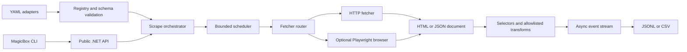

# MagicBox Universal Scraper

[](https://github.com/ShivrajY/MagicBox/actions/workflows/ci.yml)
[](https://github.com/ShivrajY/MagicBox/stargazers)
[](https://github.com/ShivrajY/MagicBox/network/members)
[](LICENSE)
[](https://dotnet.microsoft.com/download/dotnet/10.0)

MagicBox is a configuration-driven, asynchronous web-scraping framework for
.NET. It turns reviewed YAML adapters into bounded HTML/JSON extraction jobs,
with a reusable library, a command-line interface, optional Playwright browser
rendering, encrypted local secrets, and streaming JSONL/CSV output.

> MagicBox is an early public preview. The architecture is implemented and
> tested, but the project is not yet claiming stable APIs, production
> guarantees, or universal compatibility with changing third-party websites.

## Why this project exists

Small scrapers often begin as one-off scripts and become difficult to operate:
selectors drift, pagination loops indefinitely, browser sessions leak, secrets
land in source control, and a failed page can lose the rest of a run. MagicBox
puts those concerns in a shared runtime and keeps website-specific behavior in
reviewable, schema-validated adapters.

The design is deliberately conservative:

- adapters contain declarative YAML, not arbitrary F#, JavaScript, shell, or
  dynamic assemblies;
- HTTP requests have cancellation, retries, body limits, redirect validation,
  pacing, and private-network protection;
- browser rendering is optional and isolated from HTTP-only installations;
- records stream as they complete, so output is not accumulated in memory;
- robots.txt is reported for visibility, while users remain responsible for
  authorization, terms, rate limits, privacy, and applicable law.

## Architecture



The solution is split into four projects:

| Project | Responsibility |
| --- | --- |
| `MagicBox.Core` | Public contracts, adapter validation, fetching, parsing, extraction, scheduling, secrets, search facade, and sinks |
| `MagicBox.Browser` | Optional Playwright Chromium rendering, configured login flows, sessions, and manual challenge checkpoints |
| `MagicBox.Cli` | `magicbox` command-line interface and stable exit codes |
| `MagicBox.Tests` | Offline fixtures, extraction tests, pagination/safety tests, and encrypted-store tests |

See [the architecture guide](docs/architecture.md) for the execution model
and [the adapter authoring guide](docs/adapter-authoring.md) for adding a
website without writing runtime code.

## Current public scope

The repository currently includes six migrated search adapters:

| Adapter | ID |
| --- | --- |
| Google | `google` |
| Yahoo | `yahoo` |
| Bing | `bing` |
| AOL | `aol` |
| DuckDuckGo | `duckduckgo` |
| Brave | `brave` |

The v1 implementation also includes:

- CSS extraction for HTML and JSONPath extraction for JSON;
- allowlisted transforms and typed field conversion;
- page, offset, next-link, cursor, and bounded browser-click pagination;
- retry handling for transient HTTP failures and `Retry-After`;
- report-only robots diagnostics;
- local and high-volume execution profiles with bounded queues;
- AES-256-GCM encrypted secrets and session state;
- optional proxy-pool and challenge-handler boundaries;
- incremental JSONL and CSV result sinks;
- cross-platform CI for Windows, macOS, and Linux, plus a Chromium smoke job.

Known boundaries before 1.0 include no database, checkpoint/resume system,
durable queue, distributed workers, arbitrary adapter code, automatic CAPTCHA
or MFA solving, commercial proxy-provider integration, or document/OCR
extraction. SOCKS5 is represented at the infrastructure boundary but requires
an application-supplied transport handler in this release.

## Build and test

The repository pins the .NET 10 SDK in `global.json`, centralizes NuGet versions
in `Directory.Packages.props`, and checks package lock files in CI.

```bash
dotnet restore --locked-mode
dotnet build MagicBox.sln --no-restore --configuration Release
dotnet test MagicBox.sln --no-restore --configuration Release
```

The browser project is optional at runtime. Build first, then install the
versioned Chromium binary when browser rendering is needed:

```bash
dotnet build MagicBox.sln --configuration Release
pwsh src/MagicBox.Cli/bin/Release/net10.0/playwright.ps1 install chromium
```

The deterministic default test suite uses local fixtures and does not depend
on live websites. Live smoke tests, when added, must remain explicitly marked
and non-blocking.

## CLI quick start

```bash
dotnet run --project src/MagicBox.Cli -- adapter list
dotnet run --project src/MagicBox.Cli -- adapter validate adapters/builtin
dotnet run --project src/MagicBox.Cli -- scrape duckduckgo --input query=dotnet --records 10
dotnet run --project src/MagicBox.Cli -- search dotnet --engines google,bing --records 10
dotnet run --project src/MagicBox.Cli -- doctor
```

Records are written incrementally as JSONL by default. Use `--format csv` and
`--output results.csv` for CSV output. Diagnostics and summaries go to stderr.
The `local` profile is the safe default; `high-volume` only changes bounded
execution limits and never overrides a site's authorization requirements.

## Library quick start

```csharp
await foreach (var item in orchestrator.RunAsync(request, cancellationToken))
{
    if (item.Kind == ScrapeEventKind.Record)
    {
        Console.WriteLine(item.Record!.Fields);
    }
}
```

The public API uses CLR-friendly classes, enums, and interfaces so it can be
used from C#, PowerShell, and other .NET languages. The main entry point is
`IAsyncEnumerable<ScrapeEvent> RunAsync(...)`; search consumers can use
`ISearchService.SearchAsync(...)`.

## Adapter contract

Every adapter has `schemaVersion: 1`, a unique ID, an HTTP/HTTPS request,
response type (`html` or `json`), selector extraction, allowlisted transforms,
pagination policy, and required-field policy. Validation finishes before the
first network request.

Search adapters must emit `title` and an absolute `url`; `snippet` is optional.
General website adapters can emit schema-defined fields. A minimal adapter
looks like this:

```yaml
schemaVersion: 1
id: example
kind: general
inputs:
  query:
    required: true
    type: string
request:
  method: GET
  url: https://example.test/search
  query:
    q: ${input.query}
render:
  mode: http
response:
  type: html
extract:
  items:
    css: article
  fields:
    title:
      source: text
      selector: h2
      transforms: [trim]
pagination:
  strategy: none
policy:
  requiredFields: [title]
```

Read [adapter authoring](docs/adapter-authoring.md) before adding an adapter;
the fixture-first workflow is designed to keep changes deterministic and
reviewable.

## Secrets, browser sessions, and safety

`magicbox secrets init|set|list|remove|rotate` manages an AES-256-GCM text
envelope. Keys are derived from a passphrase with PBKDF2-HMAC-SHA256 and a
600,000-iteration work factor. Plaintext credentials and session state are not
stored in adapter YAML or source control. An environment passphrase is
supported for unattended runs with a warning because environment variables can
be exposed.

MagicBox blocks loopback, link-local, and private-network targets by default,
limits response bodies, revalidates redirects, restricts URI schemes to HTTP
and HTTPS, and redacts configured secrets from diagnostics. These are safety
defaults, not authorization. Users must obtain permission before scraping and
must follow applicable law and site policy.

See [SECURITY.md](SECURITY.md) for vulnerability reporting and
[CONTRIBUTING.md](CONTRIBUTING.md) for the maintainer workflow.

## Project status and maintenance

MagicBox began as a small search-engine scraping project and is being developed
into a reusable open-source library and CLI. The current maintainer is
`ShivrajY`, the owner of this repository. Maintenance work includes the
configuration schema, deterministic adapter fixtures, cross-platform CI,
security boundaries, and migration documentation.

GitHub provides the live project metrics in the badges above. This repository
does not claim package-download or production-adoption numbers that have not
been measured. Contributions, issue reports, and adapter fixtures are welcome.

## License

MagicBox is licensed under the [Apache License 2.0](LICENSE). See [NOTICE](NOTICE)
for the project attribution. Third-party dependencies retain their own
licenses.
